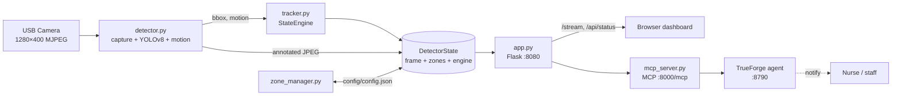
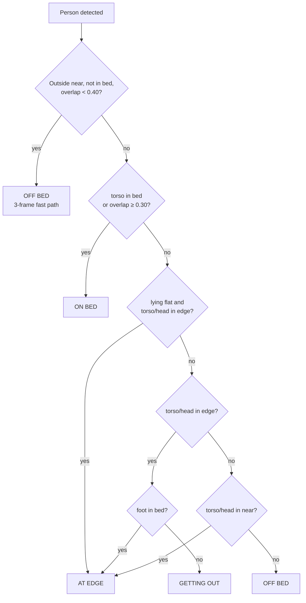
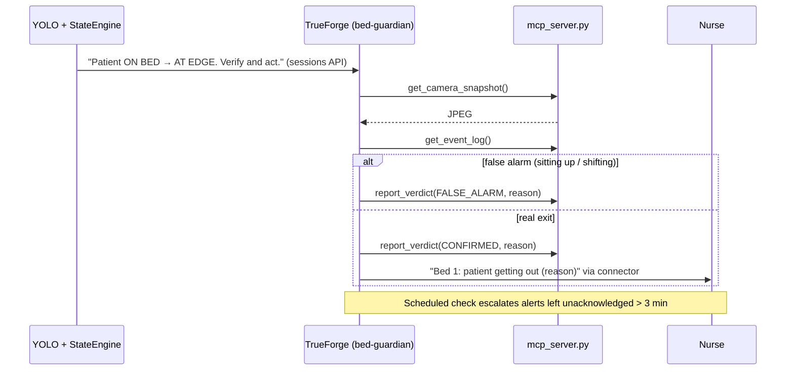

# BedDoc — Project Documentation

> Real-time, single-patient bed-exit monitoring on a Raspberry Pi 4, with a TrueForge AI agent layer for alert verification and nurse escalation.

Built for **KuboCare** (senior-care technology) · Hackathon: **Agents That Act** (HackCulture × TrueFoundry)

---

## Table of Contents

1. [Problem & Solution](#1-problem--solution)
2. [Features](#2-features)
3. [System Architecture](#3-system-architecture)
4. [Module Reference](#4-module-reference)
5. [Detection Pipeline](#5-detection-pipeline)
6. [State Engine (Core Logic)](#6-state-engine-core-logic)
7. [Zone System](#7-zone-system)
8. [Dashboard](#8-dashboard)
9. [REST API Reference](#9-rest-api-reference)
10. [TrueForge Agent Integration](#10-trueforge-agent-integration)
11. [Configuration & Tunables](#11-configuration--tunables)
12. [Installation & Running](#12-installation--running)
13. [Deployment (Raspberry Pi)](#13-deployment-raspberry-pi)
14. [Testing](#14-testing)
15. [Troubleshooting](#15-troubleshooting)
16. [Known Issues & Roadmap](#16-known-issues--roadmap)
17. [Project Structure](#17-project-structure)
18. [Tech Stack](#18-tech-stack)

---

## 1. Problem & Solution

**Problem.** Falls while getting out of bed are among the most common and serious injuries in care homes, especially at night. Staff cannot watch every room at once, and pressure-mat sensors are expensive, fragile, and only fire *after* the patient has already left the bed.

**Solution.** BedDoc uses a single USB camera and a Raspberry Pi 4 to watch one bed. A YOLOv8 person detector feeds a state machine that recognises the *progression* of a bed exit:

```
ON BED  →  AT EDGE  →  GETTING OUT  →  OFF BED
 safe      warning       alert          critical
```

Because it detects the **AT EDGE** and **GETTING OUT** stages, staff are warned *before* the patient is standing. Everything runs on-device — no video leaves the Pi.

On top of this, a **TrueForge AI agent** can look at the camera snapshot when an alert fires, judge whether it is a real exit or a false alarm, and act on it (notify, escalate, summarise).

---

## 2. Features

| Feature | Status |
|---|---|
| Live MJPEG video with zone, bounding-box and state overlays | ✅ Implemented |
| YOLOv8 person detection with 3-stage fallback (normal → low-res → high-res) | ✅ Implemented |
| 4-state bed-exit state machine with per-state debounce and grace timers | ✅ Implemented |
| Motion scoring (frame differencing) inside bed and edge zones | ✅ Implemented |
| Lying-flat posture detection (bbox aspect ratio) | ✅ Implemented |
| Click-to-draw bed and edge zones in the browser; auto-generated near zone | ✅ Implemented |
| Alert popup with audio (different tone per severity) + acknowledge | ✅ Implemented |
| Event log with timestamps | ✅ Implemented |
| Live debug panel (zone membership, candidate state, grace timer) | ✅ Implemented |
| Test mode with recorded report | ✅ Implemented |
| Camera auto-reconnect + USB reset | ✅ Implemented |
| systemd service for auto-start on boot | ✅ Implemented |
| MCP server exposing the monitor to TrueForge agents | ✅ Implemented |
| TrueForge alert-verifier + escalation agent | ✅ Implemented (`backend/agent_trigger.py`, `trueforge/setup_agent.py`, `report_verdict`) |
| Nurse proximity detection (T2) | ⏳ Planned |
| MQTT alerts to KuboCare backend | ⏳ Planned |

---

## 3. System Architecture

### 3.1 High-level data flow



### 3.2 Threading model

`app.py` owns a single `DetectorState` object and runs two things in one process:

- **Detector thread** (daemon) — `run_detector()` loops forever: read frame → YOLO → update `StateEngine` → draw overlays → store JPEG.
- **Flask threads** — serve the dashboard, the MJPEG stream and the JSON API, reading from the same `DetectorState`.

Thread safety comes from locks: `DetectorState._lock` (frame, fps, camera status), `DetectorState._zone_lock` (zones), and `StateEngine._lock` (state, log, alerts).

`mcp_server.py` runs as a **separate process** and talks to Flask over HTTP, so the AI layer can never slow down or crash the detector.

### 3.3 Design principles

- **Single patient, no tracking IDs.** Each inference picks the highest-confidence person box. Simple and robust on a Pi.
- **Edge-first.** All vision runs on the Pi; only state/alerts leave the device.
- **Conservative transitions.** Debounce and grace timers trade a few hundred milliseconds of latency for far fewer false alarms.
- **AI as a supervisor, not in the loop.** The LLM agent reacts to state changes; it never sits in the per-frame path.

---

## 4. Module Reference

### `app.py` — Flask server / entry point
- Parses CLI args, starts `run_detector()` in a daemon thread, runs Flask on `0.0.0.0:<port>`.
- Holds the global `state = DetectorState()` shared by all routes.
- Exposes the routes in [§9](#9-rest-api-reference).

CLI arguments:

| Arg | Default | Notes |
|---|---|---|
| `--camera` | `0` | `/dev/video<N>` |
| `--model` | `yolov8n` | ⚠️ Currently ignored — the detector always tries `yolov8s.pt` and falls back to `yolov8n.pt` |
| `--skip` | `2` | Run YOLO every N frames |
| `--width` | `1280` | Capture width |
| `--height` | `400` | Capture height |
| `--port` | `8080` | HTTP port |

### `detector.py` — capture, inference, overlays
- **`DetectorState`** — thread-safe container: latest JPEG, FPS, camera status, zones, `StateEngine`, motion score, test-mode log. `get_snapshot()` merges engine state with camera/zone info for `/api/status`.
- **`compute_motion_score()`** — counts pixels whose grey-level changed by > 25 between consecutive frames, masked to a polygon.
- **`draw_zones()`** — draws near (thin dark blue), edge (orange) and bed (translucent fill + label) polygons.
- **`open_camera()` / `usb_reset()`** — V4L2 MJPEG capture with 1-frame buffer; USB unbind/rebind for stuck cameras.
- **`run_detector()`** — main loop (see [§5](#5-detection-pipeline)).

### `tracker.py` — `StateEngine`
The 4-state machine. See [§6](#6-state-engine-core-logic). Public methods: `update()`, `acknowledge_alert()`, `get_snapshot()`.

### `zone_manager.py` — zone persistence
- Reads/writes `config/config.json`.
- `expand_polygon()` grows a polygon outward by N px using OpenCV morphological dilation, then simplifies the contour.
- `save_zones()` / `load_zones()` auto-generate `near_polygon`; `edge_polygon` is **never** auto-generated or modified (it is drawn by the user).
- `update_offsets()` regenerates near polygons from a new offset.
- `point_in_polygon()` wraps `cv2.pointPolygonTest`.

### `frontend/` — dashboard (`templates/index.html`, `static/css/dashboard.css`, `static/js/dashboard.js`)
Single-page app (vanilla JS, ~1000 lines). See [§8](#8-dashboard).

### `mcp_server.py` — TrueForge bridge
MCP server (Python `mcp` SDK 2.x, `MCPServer`, streamable HTTP) that wraps the Flask API as agent tools. See [§10](#10-trueforge-agent-integration).

---

## 5. Detection Pipeline

Per camera frame:

1. **Read frame.** On 10 consecutive failures → status `RECONNECTING`, reopen camera; every 3rd reconnect also performs a USB reset.
2. **Motion scores.** `motion_score` (inside bed polygon) and `motion_edge_score` (inside edge polygon) via frame differencing — computed every frame.
3. **YOLO inference** every `--skip` frames, person class only:
   | Attempt | Input | Confidence |
   |---|---|---|
   | 1 | full frame | `CONF_THRESHOLD` = 0.15 |
   | 2 (if none) | downscaled 640×200 | 0.10 |
   | 3 (if none) | 960×300, `imgsz=960` (helps lying poses) | 0.08 |

   The highest-confidence box is kept and rescaled to full-frame coordinates. Between inference frames the last result is reused.
4. **`StateEngine.update()`** with detection, bbox, zones and motion scores.
5. **Test-mode sample** every 2 s (if enabled).
6. **Overlays:** zones; bbox coloured by state; labels `AR:<ratio> FLAT|SIT|STAND`, `CONF`, `OV` (bed overlap); three keypoints — head `(cx, y1)` yellow, torso `(cx, cy)` white, foot `(cx, y2)` cyan; 2-second transition banner (`ON BED -> AT EDGE`); top status bar (state, MOT, ME, CAM, FPS).
7. **Encode** to JPEG (quality 75) and store for `/stream`.

---

## 6. State Engine (Core Logic)

### 6.1 States and alert levels

| State | Level | Name | Colour | Meaning |
|---|---|---|---|---|
| ON BED | 0 | NONE | 🟢 green | Torso in bed, or bbox overlaps bed ≥ 30 % |
| AT EDGE | 2 | WARNING | 🟠 orange | Torso/head in edge or near zone; or lying flat at the edge |
| GETTING OUT | 3 | ALERT | 🔴 red | Upright, torso/head in edge zone, foot outside bed |
| OFF BED | 4 | CRITICAL | 🔴 dark red | Outside all zones, or no person for the grace period |

### 6.2 Zone checks

For bbox `(x1, y1, x2, y2)`, with `cx`, `cy` the centre:

- **head** = `(cx, y1)`, **torso** = `(cx, cy)`, **foot** = `(cx, y2)`
- Each is tested against the bed, edge and near polygons.
- `bbox_overlap` = fraction of bbox area overlapping the bed polygon's bounding rectangle.
- `lying_flat` = `width / height ≥ 1.6`.

### 6.3 Candidate state (person detected)



### 6.4 Committing a state (debounce)

A candidate must be seen on consecutive frames before it becomes the state:

| Target | Frames required |
|---|---|
| ON BED | 10 (**15** when recovering from AT EDGE / GETTING OUT) |
| AT EDGE | 4 |
| GETTING OUT | 3 |
| OFF BED | 3 |

**No skipping:** ON BED → GETTING OUT is forced through AT EDGE first.

### 6.5 No person detected (grace timers)

When YOLO sees nobody the patient may just be under a blanket or occluded, so OFF BED is delayed:

| Situation | Behaviour |
|---|---|
| State AT EDGE and edge motion > 200 | Grace timer reset (patient still moving at edge) |
| State ON BED, bed motion < 200, torso was in bed last frame | Hold ON BED (quiet sleeper under covers) |
| State AT EDGE / GETTING OUT and both zones quiet | OFF BED after **3 s** |
| Previous state ON BED | OFF BED after **`GRACE_SAFE` = 8 s** |
| Previous state AT EDGE / GETTING OUT | OFF BED after **`GRACE_AT_RISK` = 5 s** |

### 6.6 On every committed transition
- An **alert** `{level, level_name, message, time, acknowledged:false}` is pushed (max 200 kept).
- A **log entry** `{time, prev_state, new_state, message, level, level_name, zone, role}` is pushed (max 500 kept).
- The transition is printed to stdout / journald.

`acknowledge_alert()` marks the 5 newest alerts acknowledged.

---

## 7. Zone System

All zones belong to one **bed zone** stored in `config/config.json`:

| Polygon | Created by | Drawn as | Used for |
|---|---|---|---|
| `polygon` (bed) | User clicks ≥ 4 points on the mattress | Green translucent fill + label | ON BED |
| `edge_polygon` | User draws it right after the bed zone (`edge_manual: true`) | Orange outline | AT EDGE / GETTING OUT |
| `near_polygon` | Auto: bed polygon dilated by `NEAR_OFFSET` px | Thin dark-blue outline | Last zone before OFF BED |

Example `config/config.json`:

```json
{
  "zones": [{
    "id": "zone_1778645062202",
    "label": "Bed 1",
    "color": "green",
    "type": "bed",
    "polygon":      [{"x": 727, "y": 140}, {"x": 748, "y": 331}, "..."],
    "edge_polygon": [{"x": 1295, "y": 317}, "..."],
    "near_polygon": [{"x": 577, "y": 83}, "..."]
  }]
}
```

Coordinates are in camera pixels (1280×400 by default). The dashboard converts between canvas and video coordinates, so zones stay correct at any browser size.

---

## 8. Dashboard

Open `http://<host>:8080`.

| Area | What it does |
|---|---|
| **Video** | Live `/stream` with overlays; transparent canvas on top for zone drawing |
| **Status badge** | Current state, colour and duration |
| **Draw Zone** | Click corners → click first point to close → *Save Zone*. Automatically continues to drawing the **edge** zone. *Undo* / *Cancel* available. |
| **Mapped Zones** | List of zones with edit (bed / edge) and delete |
| **Zone Settings** | *Near zone (px)* slider (50–300) → `/api/zone-settings` |
| **Debug panel** | Aspect ratio, lying-flat, motion, candidate state, grace elapsed/needed, head/torso in bed/edge/near |
| **Event log** | Timestamped state transitions |
| **Alert popup** | Level ≥ 2 shows a popup and plays a sound: single beep (AT EDGE), triple pulse (GETTING OUT), siren (OFF BED). *Acknowledge* calls `/api/acknowledge`. |
| **Test Mode** | Start/stop recording; server samples state + debug every 2 s; generates a copyable report of states and durations |

The page polls `/api/status` every second.

---

## 9. REST API Reference

Base URL: `http://<host>:8080`

| Method | Path | Body | Response |
|---|---|---|---|
| GET | `/` | — | Dashboard HTML |
| GET | `/stream` | — | `multipart/x-mixed-replace` MJPEG |
| GET | `/api/status` | — | Full snapshot (below) |
| GET | `/api/snapshot.jpg` | — | Latest annotated frame (`image/jpeg`); `503` if no frame yet |
| POST | `/api/zones` | `{"zones": [...]}` | `{"ok": true}` · `400` if empty/invalid |
| DELETE | `/api/zones/<zone_id>` | — | `{"ok": true}` |
| POST | `/api/zone-settings` | `{"edge_offset": 20–150, "near_offset": 50–300}` | `{"ok": true}` (regenerates near polygon) |
| POST | `/api/acknowledge` | — | `{"ok": true}` |
| POST | `/api/test-mode` | `{"active": true\|false}` | `{"ok": true, "test_mode": bool}` |
| GET | `/api/test-log` | — | `{"log": [{t, state, motion, debug}]}` |

### `/api/status` response

```json
{
  "patient_state": "AT EDGE",
  "state_duration_s": 4.2,
  "alert_level": 2,
  "alert_name": "WARNING",
  "nurse_nearby": false,
  "tracks": [],
  "patient_id": 1,
  "log":    [{"time": "2026-09-26 02:10:04", "prev_state": "ON BED", "new_state": "AT EDGE",
              "message": "AT EDGE", "level": 2, "level_name": "WARNING", "zone": "", "role": "patient"}],
  "alerts": [{"level": 2, "level_name": "WARNING", "message": "AT EDGE",
              "time": "2026-09-26 02:10:04", "acknowledged": false}],
  "debug":  {"ar": 0.9, "lying_flat": false, "torso_in_bed": false, "torso_in_edge": true,
             "candidate": "AT EDGE", "bbox_overlap": 0.12, "motion_score": 340, "...": "..."},
  "fps": 9.8,
  "cam_status": "OK",
  "motion_score": 340,
  "zones": [{"id": "...", "label": "Bed 1", "type": "bed", "polygon": [], "edge_polygon": []}],
  "zone_count": 1
}
```

`cam_status` ∈ `CONNECTING`, `OK`, `RECONNECTING`. `nurse_nearby`, `tracks` and `patient_id` are placeholders for future features.

---

## 10. TrueForge Agent Integration

### 10.1 Why an agent?

YOLO and the state machine are fast but only see a box and three points, so they cannot tell *"sitting up at the head of the bed"* from *"swinging legs out to stand"*. That produces the project's main false alarm. A vision-capable LLM running in **TrueForge** can look at the actual image, reason about it, and **act**: dismiss, notify, escalate, summarise.

The agent runs **above** the state machine and is triggered by state changes, so it adds no latency to detection and costs nothing while the patient is quiet.

### 10.2 Components

```
Flask API (:8080) ──HTTP──► mcp_server.py (:8000/mcp) ──MCP──► TrueForge (:8790) ──► model + connectors
```

| Component | Role |
|---|---|
| **TrueForge** | Open-source agent harness by TrueFoundry. Hosts the model, agent instructions, MCP connectors, schedules and sessions. Run locally with `npx @truefoundry/trueforge@latest`. |
| **`mcp_server.py`** | Exposes BedDoc as MCP tools over streamable HTTP. |
| **Model** | Any vision-capable model configured in TrueForge → *Settings → Models*. |

### 10.3 MCP tools (implemented)

| Tool | Backed by | Returns |
|---|---|---|
| `get_patient_status()` | `GET /api/status` | State, duration, alert level/name, camera status, FPS, motion, zone count, unacknowledged alert count |
| `get_recent_alerts(limit=10)` | `GET /api/status` | Newest alerts (max 20) |
| `get_event_log(limit=30)` | `GET /api/status` | Newest transitions (max 100) |
| `acknowledge_alerts()` | `POST /api/acknowledge` | `{"ok": true}` |
| `get_camera_snapshot()` | `GET /api/snapshot.jpg` | JPEG image content (annotated frame) |

Environment variables for `mcp_server.py`:

| Variable | Default | Purpose |
|---|---|---|
| `BEDDOC_URL` | `http://127.0.0.1:8080` | Where the Flask API lives (e.g. the Pi over Tailscale) |
| `MCP_HOST` | `127.0.0.1` | Bind address |
| `MCP_PORT` | `8000` | Port; endpoint is `/mcp` |

### 10.4 Agent use-cases

| # | Agent | Trigger | Addresses |
|---|---|---|---|
| 1 | **Alert verifier** — looks at the snapshot and confirms or dismisses AT EDGE / GETTING OUT | State change | Known false-AT-EDGE issue |
| 2 | **Nurse escalation** — notifies staff via a messaging connector; escalates if not acknowledged within N minutes | Confirmed alert + schedule | MQTT/KuboCare alert roadmap |
| 3 | **Nurse presence** — decides from the image whether a caregiver is in the room and suppresses alerts | State change | T2 nurse proximity (`nurse_nearby`) |
| 4 | **Shift handover summary** — turns the event log into a readable report | Schedule (every 8 h) | New |
| 5 | **Camera health watchdog** — alerts maintenance if `cam_status ≠ OK` or FPS drops | Schedule (every few minutes) | Silent failures |
| 6 | **Tuning assistant** — reads test-mode logs, proposes debounce/offset changes for human approval | On demand | Manual tuning |

**Hackathon build: #1 + #2 as one agent, `bed-guardian`.**



Suggested agent instructions:

> You are a bedside safety agent for a single patient. You receive bed-monitor state changes. Always call `get_camera_snapshot` first and decide whether the patient is really leaving the bed or only sitting up or shifting. Use `get_event_log` for context. Call `report_verdict`. If the verdict is CONFIRMED and the state is GETTING OUT or OFF BED, notify the nurse with a one-line summary. Never acknowledge alerts unless a human asks you to.

### 10.5 Setup

```bash
# Terminal 1 — monitor
python backend/app.py --width 1280 --height 400 --skip 3

# Terminal 2 — MCP bridge (add BEDDOC_URL=http://100.83.213.24:8080 to use the Pi)
python trueforge/mcp_server.py

# Terminal 3 — TrueForge (Node.js ≥ 22.14). Its SSRF guard blocks loopback MCP URLs unless allowed:
OUTBOUND_URL_ALLOWED_HOSTS='["127.0.0.1","localhost"]' npx @truefoundry/trueforge@latest

# Then register the connector + agent via the REST API (model must exist in Settings → Models)
python trueforge/setup_agent.py --list-models
python trueforge/setup_agent.py --model <provider/model>

# Start the monitor with the event trigger enabled
python backend/app.py --width 1280 --height 400 --skip 3 --agent bed-guardian
```

`trueforge/setup_agent.py` replaces steps 2 and 4 below.

In TrueForge (`http://localhost:8790`):

1. **Settings → Models** → choose a provider → *Configure* → paste API key → *Create*.
2. **Settings → Connectors → Add MCP Server** → `http://127.0.0.1:8000/mcp`.
3. *(Optional)* add a messaging connector (Slack / email) from the catalog.
4. **Build Agent** → model, instructions (above), MCP server `beddoc` → test in the chat panel → **Save Agent** as `bed-guardian`.
5. **Schedules** → e.g. every 2 min: *"Escalate any alert unacknowledged for more than 3 minutes."*

> TrueForge standalone mode has **no login** and stores data in local SQLite. Keep it on localhost. Its local code sandbox is unavailable on Windows; MCP tools are unaffected.

### 10.6 Event-driven trigger (implemented)

TrueForge's REST API (`http://localhost:8790/api/v1/docs`) can start an agent run on demand. Call it from `StateEngine._commit()` in a background thread, only for risky states:

```python
import threading, requests
TF = "http://localhost:8790/api/v1"

def notify_agent(prev, new):
    def run():
        s = requests.post(f"{TF}/sessions",
                          json={"agent": {"name": "bed-guardian"}}, timeout=10).json()
        requests.post(f"{TF}/sessions/{s['id']}/turns", json={
            "stream": False,
            "input": [{"type": "user.message",
                       "content": f"Patient state changed {prev} -> {new}. Verify and act."}],
        }, timeout=120)
    threading.Thread(target=run, daemon=True).start()

# in _commit(): if new_state in ("AT EDGE", "GETTING OUT", "OFF BED"): notify_agent(prev, new_state)
```

Implemented as `agent_trigger.py` (`AgentTrigger`, 20 s cooldown, one run at a time), wired via `StateEngine.on_state_change` when `app.py --agent <name>` is given. The agent reports back through the `report_verdict(verdict, reason)` MCP tool → `POST /api/agent-verdict` (`CONFIRMED` / `FALSE_ALARM` / `UNCERTAIN`) → `agent_verdict` in `/api/status` → verdict badge under the dashboard state (shown only while the state it judged is current).

---

## 11. Configuration & Tunables

Values below are the **current values in code**.

| Constant | File | Value | Effect |
|---|---|---|---|
| `CONF_THRESHOLD` | `detector.py` | 0.15 | YOLO confidence; lower = more detections, more false positives |
| `MAX_FAIL_FRAMES` | `detector.py` | 10 | Failed reads before reconnecting |
| `RECONNECT_DELAY` | `detector.py` | 3 s | Wait between reconnect attempts |
| `DEBOUNCE` | `tracker.py` | ON BED 10 · AT EDGE 4 · GETTING OUT 3 · OFF BED 3 | Frames before committing |
| Recovery debounce | `tracker.py` | 15 | Frames to return to ON BED from a risky state |
| `GRACE_SAFE` | `tracker.py` | 8.0 s | No-person time before OFF BED when last state was ON BED (consider 30 s at night) |
| `GRACE_AT_RISK` | `tracker.py` | 5.0 s | Same, when last state was AT EDGE / GETTING OUT |
| Fast grace | `tracker.py` | 3.0 s | When at risk and both zones are quiet |
| `LYING_FLAT_RATIO` | `tracker.py` | 1.6 | bbox w/h at/above this counts as lying flat |
| `MOTION_HOLDBACK_THRESH` | `tracker.py` | 200 px | Motion threshold for holdback logic |
| `NEAR_OFFSET` | `zone_manager.py` | 120 px | Near-zone dilation (also via dashboard slider) |
| `EDGE_OFFSET` | `zone_manager.py` | 50 px | Stored only; edge zone is drawn manually |
| `--skip` | CLI / service | 2 (service) | YOLO every N frames; higher = smoother video, slower reactions |

---

## 12. Installation & Running

### Requirements
- Python 3.10+ (developed with 3.14 on Windows, Pi OS Python on the Pi)
- USB camera (tested: Jieli MJPEG, 1280×400)
- Node.js ≥ 22.14 (only for TrueForge)

### Setup

```bash
python3 -m venv venv
source venv/bin/activate          # Windows: venv\Scripts\activate
pip install -r requirements.txt   # flask, ultralytics, opencv-python-headless, numpy, mcp, requests
```

YOLO weights `yolov8s.pt` (preferred) and `yolov8n.pt` (fallback) are in the project root.

### Run

```bash
python backend/app.py --width 1280 --height 400 --skip 3
# → http://localhost:8080
```

### First use
1. Click **✏️ Draw Zone**, click the 4 corners of the mattress, click the first point again to close, **Save Zone**.
2. The dashboard switches to drawing the **edge** zone: outline the danger area around the bed, **Save Zone**.
3. The near zone is generated automatically; adjust with the *Near zone* slider.
4. Walk through the states to check them:

| Action | Expected |
|---|---|
| Lie / sit on mattress | ON BED |
| Move to the side of the bed | AT EDGE |
| Stand up beside the bed | GETTING OUT |
| Walk away | OFF BED |
| Return and lie down | ON BED |

---

## 13. Deployment (Raspberry Pi)

| Item | Value |
|---|---|
| Host | `kcpi2508-l-027` (Tailscale `100.83.213.24`) |
| User | `pi` |
| App dir | `/home/pi/BedDoc` |
| Venv | `/home/pi/BedDoc/venv` (symlink to `/home/pi/bed-sentry/venv`) |
| Camera | `/dev/video0` |
| Service | `beddoc.service`, port 8080 |

### Install the service (first time)

```bash
sudo cp deploy/beddoc.service /etc/systemd/system/
sudo systemctl daemon-reload
sudo systemctl enable --now beddoc
```

The service runs `python backend/app.py --width 1280 --height 400 --skip 2` from `/home/pi/BedDoc` and restarts automatically after 5 s on failure.

### Update

```bash
bash deploy/deploy.sh   # scp backend/ + frontend/ to ~/BedDoc → install unit → restart beddoc
```

`deploy/deploy.sh` does **not** copy `trueforge/`. Migrating from the old `~/bed-sentry-v3` layout is described in the README. The recommended setup runs the MCP server and TrueForge on a laptop with `BEDDOC_URL=http://100.83.213.24:8080`.

### Operate

```bash
sudo systemctl status beddoc
sudo journalctl -u beddoc -f
```

---

## 14. Testing

**Test mode (dashboard).** *▶ Start Test* → perform a scenario → *Stop*. The server samples state, motion and debug every 2 s. The report lists each state with its duration and can be copied for tuning discussions.

**API smoke test.**

```bash
curl http://localhost:8080/api/status
curl -o frame.jpg http://localhost:8080/api/snapshot.jpg
curl -X POST http://localhost:8080/api/acknowledge
```

**MCP smoke test** (all five tools were verified this way against a stub API):

```python
import asyncio
from mcp import ClientSession
from mcp.client.streamable_http import streamable_http_client

async def main():
    async with streamable_http_client("http://127.0.0.1:8000/mcp") as (r, w):
        async with ClientSession(r, w) as s:
            await s.initialize()
            print([t.name for t in (await s.list_tools()).tools])
            print(await s.call_tool("get_patient_status", {}))

asyncio.run(main())
```

---

## 15. Troubleshooting

| Symptom | Fix |
|---|---|
| Video frozen / low FPS | Increase `--skip` (3–5); check camera with `v4l2-ctl --list-devices` |
| `CAM: RECONNECTING` stays | Check USB cable/power; service user needs access to `/dev/video0` (the app runs `sudo chmod 666`) |
| Zone not visible after save | Hard refresh (`Ctrl+Shift+R`); check `config/config.json` is writable |
| Person not detected | Improve lighting; make sure part of the body is visible; lower `CONF_THRESHOLD` |
| Never reaches AT EDGE | Draw the bed zone on the mattress surface only; draw the edge zone wider |
| False AT EDGE when sitting up | Known issue — see §16; the TrueForge verifier agent is the proposed fix |
| OFF BED too fast at night | Increase `GRACE_SAFE` (e.g. 30 s) |
| MCP tools error in TrueForge | Check `python trueforge/mcp_server.py` is running and `BEDDOC_URL` reaches the Flask app |
| `No module named 'mcp.server.fastmcp'` | You have mcp 2.x; the code uses `mcp.server.mcpserver.MCPServer` — update `mcp_server.py` from the repo |
| `get_camera_snapshot` fails with 503 | Detector has not produced a frame yet (camera connecting) |

---

## 16. Known Issues & Roadmap

### Known issues
- **False AT EDGE** when the patient sits up at the head of the bed: with an angled camera the torso point leaves the bed polygon.
- `--model` CLI argument is ignored (always `yolov8s` → `yolov8n` fallback).
- `EDGE_OFFSET` / `edge_offset` has no effect since edge zones became manual.
- `README.md` and `CLAUDE.md` list older tunable values (`DEBOUNCE 10`, `OFF_BED_GRACE 5 s`, auto-generated edge zone); §11 of this document reflects the current code.
- The dashboard has no authentication; keep it on a trusted network / Tailscale.

### Roadmap
1. **TrueForge `bed-guardian` agent** — event trigger, `report_verdict` tool, dashboard verdict badge.
2. **Nurse escalation** via TrueForge connectors, then **MQTT to KuboCare** backend.
3. **Nurse proximity (T2)** — second-person detection and/or agent vision check to fill `nurse_nearby`.
4. Night mode (longer `GRACE_SAFE`, IR camera support).
5. Multi-bed support (one Pi per room, central dashboard).

---

## 17. Project Structure

```
BedDoc/
├── backend/
│   ├── app.py              # Flask server, API routes, starts detector thread
│   ├── detector.py         # Camera loop, YOLO, motion, overlays, DetectorState
│   ├── tracker.py          # StateEngine — 4-state bed-exit machine
│   ├── zone_manager.py     # config/config.json persistence, polygon dilation
│   ├── agent_trigger.py    # Starts TrueForge agent runs on risky states
│   └── paths.py            # Project paths
├── frontend/
│   ├── templates/index.html        # Dashboard layout
│   └── static/css/dashboard.css, static/js/dashboard.js
├── trueforge/
│   ├── mcp_server.py       # MCP bridge for TrueForge agents
│   └── setup_agent.py      # Registers connector, model and bed-guardian agent
├── config/
│   ├── config.json         # Saved zones
│   └── bytetrack.yaml      # Legacy (tracking no longer used)
├── models/                 # yolov8s.pt / yolov8n.pt
├── deploy/
│   ├── deploy.sh           # scp + restart on the Pi
│   └── beddoc.service      # systemd unit
├── docs/
│   ├── DOCUMENTATION.md    # This file
│   └── CONTEXT.md          # Hardware / deployment notes
├── requirements.txt
├── README.md               # Quick start
└── CLAUDE.md               # AI-assistant guidance
```

---

## 18. Tech Stack

| Layer | Technology |
|---|---|
| Hardware | Raspberry Pi 4 (4 GB), USB MJPEG camera |
| Detection | Ultralytics YOLOv8 (s / n) |
| Vision utilities | OpenCV, NumPy |
| Backend | Flask (threaded) |
| Frontend | Vanilla HTML / CSS / JavaScript, Canvas, Web Audio |
| Agent layer | TrueFoundry **TrueForge**, Model Context Protocol (`mcp` Python SDK 2.x) |
| Ops | systemd, Tailscale, scp |

---

*BedDoc · KuboCare*
